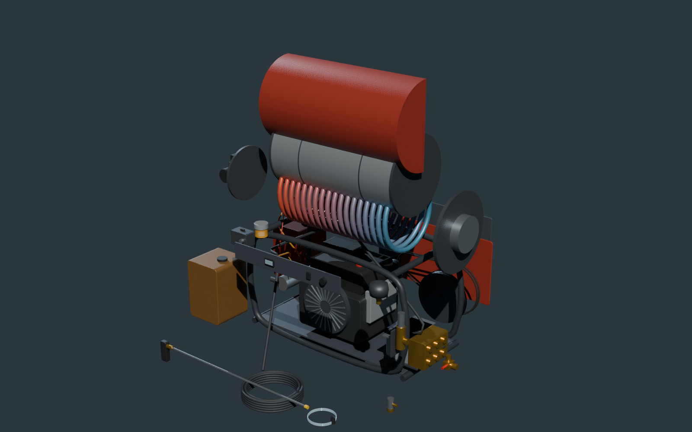

# Proline Washer Bench

Interactive shop reference for two hot-water pressure washers: **5355J** and **8405HNL**.



- **Exploded view:** Three.js models of each whole machine, water pump, oil burner, unloader and trigger gun. Includes an explode slider, running motion, water and fuel flow, and clickable parts.
- **Troubleshoot:** every symptom table from both manuals, as a checklist. Each cause links to the part in 3D, the procedure and the part number.
- **Parts:** all transcribed rows, kits and tools, with search, filters and a copyable order list.
- **Tools:** tools and supplies for each machine, with what the manuals list and what the work implies, and a tick list for what the shop has.
- **Maintenance:** schedule driven by the hour meter, service record, and step-by-step procedures.
- **Specs and manual errors:** printed specs, torque values, and places where the manuals conflict.

## Hosting
This folder is served at `/washer/` by GitHub Pages from the repository root.

`index.html` is self-contained apart from Three.js r147 from jsDelivr and fonts from Google Fonts. On GitHub Pages, hours and the service record save in each visitor's browser, not on a shared server.

## Files
| Path | Contents |
| --- | --- |
| `index.html` | The built page |
| `models/*.glb` | Every scene as GLB, in metres, with a 4 second `Explode` animation |
| `blender/*.blend` | Each whole machine imported into Blender, with the animation, camera and lights |
| `src/` | `data.js` parts and specs, `guides.js` troubleshooting and procedures, `model.js` 3D, `app.js` UI |
| `tools/` | `build.py`, `export_glb.js`, `blender_scene.py`, plus checks: `check.js` and `verify_parts.py` |

## Rebuild
```
python3 tools/build.py                 # writes index.html
node tools/export_glb.js               # needs playwright, NM=<node_modules with three@0.147.0>, GLB_OUT=<folder>
python3 tools/blender_scene.py model.glb out.blend poster.png   # pip install bpy, or run inside Blender
```

## Accuracy
Data comes from the Alkota service manuals p/n 5355J-000000 (2023-12-13) and 8405HNL-X00020 (2022-10-20). The manuals are not included here. Page numbers refer to PDF pages.

The models are schematic. They are laid out from the assembly drawings and printed dimensions, and they are not manufacturer CAD. Do not measure from them. This is an unofficial reference, not an Alkota publication.
